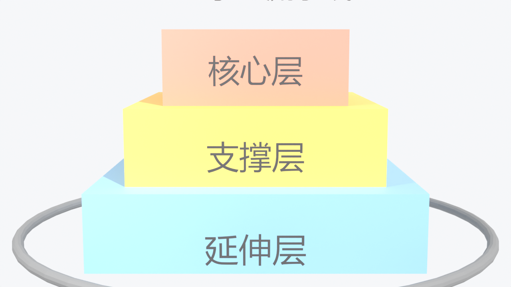
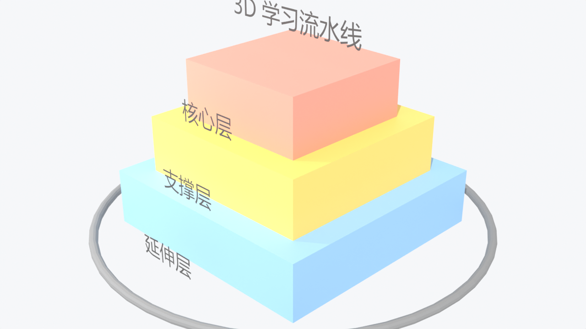
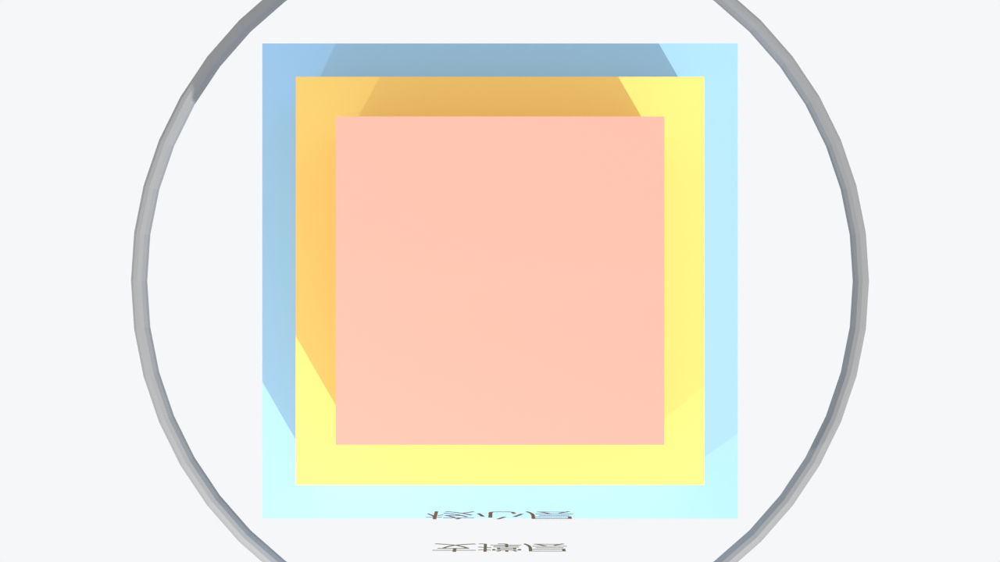

# blender-learn-pipeline — Blender 3D 学习流水线

把「学一个东西」从线性阅读升级成一条**固定流水线**：

```
拆到底层 → 建体系 → Blender 3D 可视化 → 讲清本质 → 自检闭环
```

**当前版本：v1.1.1**

核心立场：看懂每一行字 ≠ 脑子里有画面。抽象概念的困难不在公式难，而在它们本质是**结构或过程**——结构与过程必须被立起来看。本技能把「立起来看」固定为流水线第三段，一律用本机 Blender 无头渲染出**真 3D 产物**（多视角 PNG + 360° 环绕 mp4），不交付想象中的图。

## 概念图（真机渲染，非示意图）

| 主视角 | 等轴视角 |
|---|---|
|  |  |

<p align="center"></p>

> 以上三张均为技能自带的「知识体系塔」演示场景，由 Blender 5.2 无头渲染产出——三层塔对应流水线的体系坐标（核心层/支撑层/延伸层），底部圆环对应五段循环。

## 流水线五段

| 阶段 | 产出 | 出口判据（不过不放行） |
|---|---|---|
| 1 拆到底层 | 隐含假设表 + 原子事实清单 + 推理链 | 推理链每步能写出「由 A+B 推出 C」 |
| 2 建体系 | 三层依赖 DAG + 跨学科坐标 + **3D 主体选型** | 已明确「哪个结构值得立起来看」 |
| 3 Blender 3D 可视化 | ≥3 视角 PNG + 360° 环绕 mp4（真机渲染） | 文件真实存在、中文标注不糊、无报错 |
| 4 讲清本质 | 一句话本质 + 类比 + 失效边界 + 存在动机 | 本质句能对应到 3D 画面中的具体镜头 |
| 5 自检闭环 | 3–5 道自检题 + 3D 复述测试 | 看着渲染图能把推理链讲一遍 |

## 环境要求

- Blender ≥ 4.x（5.x 实测通过），无需 pip 依赖
- Windows 字体（微软雅黑/黑体任一，用于中文标注）；Linux/Mac 改 `FONT_CANDIDATES` 路径即可
- AI 宿主（WorkBuddy / Claude Code 等）需具备「读文件 + 执行命令 + 写文件」能力

## 安装

把 `blender-learn-pipeline/` 整个目录复制到宿主的技能目录（WorkBuddy：`~/.workbuddy/skills/`），或直接下载 [Releases](../../releases) 的 zip 解压进去。

## 用法

### 方式一：作为技能触发（推荐）

装好后对 AI 说：

- 「用 Blender 3D 把 Transformer 注意力机制立起来讲一遍」
- 「3D 学习流水线：TCP 三次握手」
- 「我想边练 Blender 边学递归」

### 方式二：直接命令行渲染演示场景

```bash
BLENDER="C:/Program Files/Blender Foundation/Blender 5.2/blender.exe"
"$BLENDER" --background --factory-startup \
  --python blender_learn.py -- --out 输出目录 --frames 24 --samples 48
```

| 参数 | 默认 | 说明 |
|---|---|---|
| `--out` | 必填 | 输出目录 |
| `--frames` | 24 | 环绕帧数（≥2），24 帧 @24fps ≈ 1 秒循环 |
| `--samples` | 48 | Cycles 采样（≥1） |
| `--fps` | 24 | 环绕视频帧率 |
| `--prefix` | turntable | 环绕视频文件名前缀 |
| `--no-turntable` | 关 | 只渲染静帧 |

### 方式三：写自己的主题场景（核心用法）

```python
import bpy, sys
sys.path.insert(0, r"...\blender-learn-pipeline\scripts")
from blender_learn import (clear_scene, setup_world, add_light, add_box,
                           add_label, add_camera, setup_render,
                           render_stills, render_turntable)

clear_scene(); setup_world()
add_light("Key", type_='SUN')
add_box("核心", size=(2.2, 2.2, 0.9), location=(0, 0, 0.45), color=(0.85, 0.33, 0.25))
add_label("核心层", location=(0, -1.6, 0.45), size=0.42)

setup_render(samples=48)
add_camera(location=(7, -7, 5), target=(0, 0, 1))
render_stills("render")          # 三视角 PNG
render_turntable("render")       # turntable.mp4
```

```bash
"$BLENDER" --background --factory-startup --python [主题]_scene.py -- --out 输出目录
```

### 打包与版本

```bash
python package.py           # 版本 patch+1，同步文档，出 dist zip
python package.py --minor   # minor+1
python package.py --no-bump # 不递增仅重打包
```

## 使用实例（20 个）

以下均为可直接对 AI 说的完整指令：

**层次 / 体系结构类**

1. 「用 Blender 3D 学习流水线讲 TCP/IP 四层模型，把每层做成一个块体」
2. 「3D 学习流水线：操作系统内存分层（寄存器/缓存/内存/磁盘），做成分层塔」
3. 「我想搞懂 OSI 七层模型，用 Blender 立起来看，每层配中文标注」
4. 「把马斯洛需求层次做成 Blender 3D 金字塔，走完整学习流水线」
5. 「用 Blender 讲解公司组织架构：董事会/管理层/执行层三层塔」

**过程 / 流转类**

6. 「3D 学习流水线：把 HTTP 请求生命周期做成管道流动模型」
7. 「用 Blender 3D 讲编译器流程：源码→词法→语法→AST→机器码，做成流水线管道」
8. 「把 Git 的 add/commit/push 工作区流转做成 Blender 3D 模型」
9. 「3D 学习流水线：消化系统食物旅程，做成管道+器官标注」
10. 「用 Blender 讲 HTML 请求到页面渲染的关键渲染路径」

**空间关系 / 结构类**

11. 「把细胞器结构做成 Blender 3D 剖面模型，走五段学习流水线」
12. 「3D 学习流水线：地球内部圈层（地壳/地幔/地核），做成分层球」
13. 「用 Blender 3D 讲 DNA 双螺旋结构，标注碱基配对」
14. 「把晶体结构（NaCl 晶格）做成 Blender 空间点阵学习包」
15. 「3D 学习流水线：太阳系八大行星轨道，做环绕镜头」

**机制原理类**

16. 「用 Blender 3D 讲齿轮传动比原理，两个咬合齿轮+转速标注」
17. 「把杠杆原理做成 Blender 3D 演示，走完整学习流水线」
18. 「3D 学习流水线：讲滑轮组省力机制，动滑轮定滑轮组装」
19. 「用 Blender 讲街舞 Breaking 的 Toprock→Footwork→Freeze 流程层次」
20. 「3D 学习流水线：把门业免漆门生产工艺（基材→压贴→开槽→包覆）做成 3D 流程线」

> 提示：概念本身无空间性时（纯定义类），AI 会用隐喻式表达（塔/管道/齿轮）并在学习卡中标注「此为隐喻非实体」。

## 产物一览

```
[主题]/
├── [主题]—3D学习流水线.md      # 学习主卡（五段全记录）
├── [主题]_scene.py             # 可复跑的场景脚本
└── render/
    ├── 01-主视角.png  02-等轴视角.png  03-俯视角.png
    └── turntable.mp4           # 360° 环绕（H264）
```

## 质量底线

- 真机渲染：文件存在且非 0 字节才交付，产物自检内置在助手库里
- 中文标注：自动探测系统 CJK 字体，交付前看图确认
- 限时降级：单件渲染 5 分钟无产物 → 降帧/降采样/减视角 → 静态图，注明降级路径
- 隐喻标注：无空间性的概念用隐喻表达时必须显式声明

## 排错速查

| 症状 | 处理 |
|---|---|
| 中文豆腐块 | 确认走 `add_label()`（自动加载系统 CJK 字体） |
| 块体表面文字重影 | 文字对象需 `visible_glossy=False` + `visible_shadow=False`（助手库已内置） |
| `Action has no attribute 'fcurves'` | Blender 5.x 移除，用助手库 `_linearize()` 兼容层 |
| `enum "FFMPEG" not found` | 5.x 改用 `image_settings.media_type='VIDEO'` |
| 渲染慢 | `--samples 16` + `--frames 12` 先出样张 |

详细排错见 [技术手册](技术手册.md) 第六节。

## 文档

- [用户手册](用户手册.md) — 怎么用、每阶段得到什么、常见问题
- [技术手册](技术手册.md) — 架构、API 参考、兼容层、验证方法

## License

MIT
